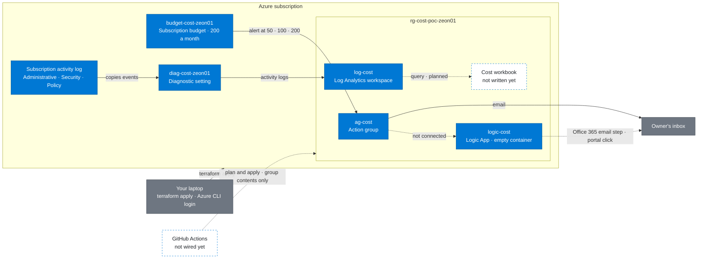

# Cost visibility on Azure

## Watch the walkthrough

Not recorded yet.

**Author:** Zeon Stewart, [LinkedIn](LINKEDIN_LINK_HERE)

## At a glance

- **What it is:** a monthly budget on the Azure subscription, plus a workspace that receives the subscription activity log. The budget emails an action group at 25, 50, and 100 percent of 200. It does not stop spending.
- **What's automated:** Terraform creates the resource group, the Log Analytics workspace, the action group, the budget, an empty Logic App, and the diagnostic setting. `./scripts/verify.sh` checks them after they exist. `./scripts/teardown.sh` removes them after the resource group name is typed.
- **Why it's secure:** the alert address is not in the repository. State is stored in a shared account with shared keys off, and Terraform signs in with Microsoft Entra. The published outputs are names only.
- **Result:** On 26 Nov 2026, `terraform apply` printed `Apply complete! Resources: 6 added, 0 changed, 0 destroyed.` `az group exists --name rg-cost-poc-zeon01` printed `true`. `./scripts/verify.sh` printed 9 PASS and 1 FAIL: Cost Management returned no month-to-date rows, so line 6 did not invent a crossing. `terraform plan` after apply printed no changes.

Part of [Cloud Projects](https://github.com/zsociety47/cloud-projects). Technical details are in [Technical findings](#technical-findings) at the bottom.

---

## Project Steps

These steps follow the files in the order each one needs the one before it. Have Terraform 1.15 and the Azure command-line interface (CLI) installed, and sign in with `az login` before the first plan.

Set the subscription for the terminal session without writing it into a file:

```bash
export ARM_SUBSCRIPTION_ID="$(az account show --query id -o tsv)"
```

`ARM` is the prefix the Azure Resource Manager provider uses for its environment variables. Read each plan before you type `yes`.

The alert address has no default. Put it in a file named `.env` in this folder. That file is gitignored.

```bash
TF_VAR_alert_email='your-address'
```

Do not commit `.env`.

### Step 1: Sign in and pin the provider

*Automated by `provider.tf` and `versions.tf`.*

1. Confirm the Azure CLI login is the subscription you mean to use.
2. Leave `resource_provider_registrations = "none"`. An apply must not register providers as a side effect.

<!--  -->

### Step 2: Create the resource group

*Automated by `tags.tf` and `resource_group.tf`.*

1. The group name is `rg-cost-poc-zeon01`, in East US.
2. The tags include `lifetime = 1d`, `owner`, `project`, and `created`. The nightly delete reads `lifetime = 1d`.

<!--  -->

### Step 3: Create the workspace

*Automated by `log_analytics.tf`.*

1. The workspace name is `log-cost`.
2. The pricing is `PerGB2018`, which bills for data ingested. Retention is 30 days. There is no daily reservation.

<!--  -->

### Step 4: Create the action group

*Automated by `action_group.tf`.*

1. The action group name is `ag-cost`. The short name is `costalerts`.
2. One email receiver is named `owner-email`. The address comes from `TF_VAR_alert_email`.

<!--  -->

### Step 5: Create the subscription budget

*Automated by `budget.tf`.*

1. The budget name is `budget-cost-zeon01`. The amount is 200. The grain is monthly. The start date is the first day of November 2026.
2. Alerts fire at 25, 50, and 100 percent of actual spend, and only when spend goes above the line. Each alert contacts `ag-cost`.
3. This budget is not inside the resource group. Deleting the group does not delete it.

<!--  -->

### Step 6: Create the Logic App container

*Automated by `logic_app.tf`.*

1. The Logic App name is `logic-cost`. The workflow steps are not in Terraform.
2. The HTTP trigger and the Office 365 email step are clicks in the portal after the container exists.

<!--  -->

### Step 7: Forward the activity log

*Automated by `diagnostic.tf`.*

1. The diagnostic setting name is `diag-cost-zeon01`.
2. It copies the Administrative, Security, and Policy categories into `log-cost`.
3. This setting is not inside the resource group. Copying these logs can incur ingestion charges.

<!--  -->

### Step 8: Check the live resources

*Automated by `./scripts/verify.sh`.*

1. Run the script only after apply has created the resources.
2. Ten lines print. Exit 0 means all ten passed. The script does not print the subscription id or the alert address.

<!--  -->

### Step 9: Clean up when you're done

*Automated by `./scripts/teardown.sh`.*

1. Type `rg-cost-poc-zeon01`.
2. Read the destroy plan and type `yes`.
3. That removes the group, the budget, and the diagnostic setting. The nightly delete removes only the group.

<!--  -->

---

## Automated setup

### Run this as yourself

The names in this repository are the ones I used for my own proof of concept, so leave them as they are. Make your own copy and swap my short name (`zeon`) for yours. The names follow the [naming standard](https://github.com/zsociety47/cloud-projects/blob/main/standards/NAMING-STANDARD.md): type, project or role, environment, then your short name and a number on top-level names only (`rg-cost-poc-zeon01` becomes `rg-cost-poc-ada01`).

| Open this | Do this |
|---|---|
| [`terraform.tfvars.example`](terraform.tfvars.example) | Copy to `terraform.tfvars` (gitignored). Replace `yourname01` and `tags.owner`. If your short name is not `zeon`, also set `budget_name` and `diagnostic_setting_name` in that copy. Do not put the alert address in this file. |
| [`variables.tf`](variables.tf) | Leave this one alone. Its defaults are the names from my own proof. |
| [`backend.tf`](backend.tf) | Leave this one alone if you are using this proof's shared state account. On your own subscription, point it at your state account and your own blob key. |

```bash
cp terraform.tfvars.example terraform.tfvars
```

Create `.env` in this folder. It is gitignored.

```bash
TF_VAR_alert_email='your-address'
```

Then the rest of this section, using the names you just set.

### Sign in

The provider uses the Azure CLI login already on this machine. The subscription id is not stored in a file.

```bash
az login
export ARM_SUBSCRIPTION_ID="$(az account show --query id -o tsv)"
```

You should see the account name you expect. Do not paste the id into a file or into the README.

### Initialize

`backend.tf` points state at the shared account `sttfstatezeon01`, container `tfstate`, blob `cost-dashboard.tfstate`. Shared keys are off, so init signs in with Microsoft Entra.

```bash
terraform init -input=false
```

You should see `Terraform has been successfully initialized!` before you plan. If init fails, stop. Do not apply.

### Plan

```bash
set -a
source .env
set +a
terraform plan -input=false
```

Read the plan. This configuration adds six resources: the group, the workspace, the action group, the budget, the Logic App, and the diagnostic setting. A plan that contains `/subscriptions/` is not a screenshot.

Three resource providers were not registered when these files were written: `Microsoft.Insights`, `Microsoft.Logic`, and `Microsoft.OperationalInsights`. `Microsoft.Consumption` was already registered. Register the three by name before apply, so the change is visible. An apply must not register them as a side effect.

```bash
az provider register --namespace Microsoft.Insights
az provider register --namespace Microsoft.Logic
az provider register --namespace Microsoft.OperationalInsights
```

Those three commands have not been run from this repository.

### Apply

Do not apply until the plan has been read and the three providers are registered. Apply from the laptop. The GitHub identity, once it exists, is a Contributor on the resource group only. It cannot create the subscription budget or the subscription diagnostic setting.

```bash
terraform apply -input=false
```

Type `yes` only after the plan matches the six resources above. The names that print are `rg-cost-poc-zeon01`, `log-cost`, `ag-cost`, `budget-cost-zeon01`, `logic-cost`, and `diag-cost-zeon01`.

### Verify

Run this only after apply.

```bash
./scripts/verify.sh
```

Ten lines. Exit 0 when all pass. Line 6 passes when month-to-date spend has not crossed 25 percent of 200, because the alert uses `GreaterThan` and this check does not fake a crossing.

### Teardown

```bash
./scripts/teardown.sh
```

Type `rg-cost-poc-zeon01`, then type `yes` for Terraform's own prompt. Nothing is deleted on a mismatched name.

---

## Architecture

The design picture is still a draft at `docs/architecture/architecture-draft.png`. It is not the final picture. The map below is the live one, and it follows the Terraform files.



*Caption: The subscription budget warns the action group at 50, 100, and 200 of actual spend, and the action group emails the owner. The activity log is copied into a Log Analytics workspace by a subscription diagnostic setting. The budget and that setting sit outside the resource group, so the nightly delete skips them. The Logic App email step is a portal click and is not connected to the action group. GitHub Actions is drawn as planned because the three Azure secrets and the projects map are not set.*

How to read this diagram: solid arrows are the path spend alerts and activity logs take. Dashed arrows are a portal click, a planned query, or a pipeline that is not wired. Azure resources are blue. The laptop and the inbox are gray. Outlined nodes are not built yet.

---

## Hypothesis

A subscription budget and an activity-log workspace can warn a person before a bill is a surprise, without stopping the spend and without putting the alert address in the repository.

## Success criteria

| # | Criterion | How it is checked | Result |
|---|-----------|-------------------|--------|
| 1 | The group is in East US and has the four sweep tags | `./scripts/verify.sh` lines 1 and 2 | ✅ 26 Nov 2026 |
| 2 | The workspace is PerGB2018 for 30 days with no reservation | `./scripts/verify.sh` line 3 | ✅ 26 Nov 2026 |
| 3 | The action group has one email receiver and does not print the address | `./scripts/verify.sh` line 4 | ✅ 26 Nov 2026 |
| 4 | The budget is 200, monthly, from 2026-11-01, with three GreaterThan Actual alerts | `./scripts/verify.sh` line 5 | ✅ 26 Nov 2026 |
| 5 | Spend under the first line does not count as a fired alert | `./scripts/verify.sh` line 6 | ❌ 26 Nov 2026: Cost Management returned no rows |
| 6 | The group has no policy assignment | `./scripts/verify.sh` line 7 | ✅ 26 Nov 2026 |
| 7 | The Logic App container exists | `./scripts/verify.sh` line 8 | ✅ 26 Nov 2026 |
| 8 | The diagnostic setting sends three categories to `log-cost` | `./scripts/verify.sh` line 9 | ✅ 26 Nov 2026 |
| 9 | `terraform plan` reports no changes after apply | `./scripts/verify.sh` line 10 | ✅ 26 Nov 2026 |

## What's in this repository

```text
backend.tf                 remote state blob cost-dashboard.tfstate
versions.tf                Terraform ~> 1.15, azurerm 5.10.0
provider.tf                Azure CLI login, no provider registration
variables.tf               names, amounts, and the alert address variable
tags.tf                    lifetime 1d and created
resource_group.tf          rg-cost-poc-zeon01
log_analytics.tf           log-cost
action_group.tf            ag-cost
budget.tf                  budget-cost-zeon01
logic_app.tf               logic-cost, empty
diagnostic.tf              diag-cost-zeon01
outputs.tf                 six names, no ids
scripts/verify.sh          ten checks after apply
scripts/teardown.sh        typed name, then terraform destroy
.github/workflows/         callers of the shared plan and apply workflows
terraform.tfvars.example   copy for a later operator
docs/architecture/         draft picture, not the final one
```

## Security choices

- **The alert address is an environment variable.** `alert_email` has no default and is marked sensitive. It is not in `terraform.tfvars.example`.
- **State uses Microsoft Entra, not a storage key.** `use_azuread_auth` is true because the shared account has shared keys off.
- **Outputs are names.** The workspace id contains the subscription id, so it is not an output. The Logic App access endpoint is not the HTTP trigger address, so it is not an output.
- **The GitHub workflow does not set a GitHub environment.** A GitHub environment would change the OpenID Connect subject, and Azure would refuse the sign-in. OpenID Connect is the sign-in that uses a short-lived token instead of a stored password.
- **A push to `main` starts apply.** Do not push this repository to `main` until the three Azure secrets exist. A documentation commit can include `[skip ci]` so that push does not start apply.

## Cost

The budget amount of 200 is a warning line, not a charge and not a cap. The workspace bills for gigabytes ingested under `PerGB2018`. Forwarding the subscription activity log can add to that bill. There is no daily reservation. The Logic App container has no workflow yet, so it does not send mail. Tear down with `./scripts/teardown.sh` when the proof is finished. The nightly delete removes the group only, and it will not remove the budget or the diagnostic setting.

## Going further

- Add the Cost Management workbook after the query is approved. It is not in this configuration.
- Add the Logic App HTTP trigger and the Office 365 email step in the portal, then connect that app to the action group.
- Register `Microsoft.Insights`, `Microsoft.Logic`, and `Microsoft.OperationalInsights` by name before the first apply.
- After the resource group exists, add this repository to the shared pipeline's projects map and set the three Azure secrets. Until then, GitHub Actions cannot create the budget or the diagnostic setting.

---

## Technical findings

*For engineers: what was decided while writing the files, and what the first apply printed.*

- **The export start date was outside the current month.** The export used `2026-03-01T00:00:00Z`. A monthly budget must start on the first day of the current month. This file uses `2026-11-01T00:00:00Z`.
- **The export callback output is the wrong address.** `access_endpoint` is not the HTTP trigger URL. `outputs.tf` prints names only.
- **The workspace and the Logic App do not use the export's abbreviations.** The names are `log-cost` and `logic-cost`.
- **`GreaterThan` does not fire on an exact match.** Spend that lands on 50, 100, or 200 does not alert. Verify line 6 passes at or under 50.
- **The budget and the diagnostic setting are subscription scoped.** The nightly script deletes a group tagged `lifetime=1d`. It does not delete these two. `terraform destroy` does, because they are in the configuration.
- **GitHub Actions cannot create the subscription resources.** The planned identity is a Contributor on the resource group. The laptop login creates the budget and the diagnostic setting.
- **Three providers were not registered.** `Microsoft.Insights`, `Microsoft.Logic`, and `Microsoft.OperationalInsights`. `Microsoft.Consumption` printed `Registered` on October 28, 2026. Apply must not register the other three as a side effect. On 26 Nov 2026, `az provider register --wait` on those three printed `Registered` for each, then apply ran with `resource_provider_registrations = "none"`.
- **Init on November 26, 2026.** `terraform init -input=false` configured the `azurerm` backend and printed `Terraform has been successfully initialized!` It installed `hashicorp/azurerm` v5.10.0 and wrote `.terraform.lock.hcl`. `terraform validate` printed `Success! The configuration is valid.`
- **The budget id has to be a path.** The first plan failed with `parsing the Subscription ID: the number of segments didn't match`. The data source returns the id alone. `azurerm_consumption_budget_subscription` in provider 5.10.0 requires `/subscriptions/<id>`. `budget.tf` now builds that path. The id was not printed.
- **Plan on November 26, 2026.** After that fix, `terraform plan -input=false` printed `Plan: 6 to add, 0 to change, 0 to destroy.` The six are the group, the workspace, the action group, the budget, the Logic App, and the diagnostic setting. The email printed as `(sensitive value)`.
- **Apply on November 26, 2026.** `terraform apply -auto-approve -input=false` printed `Apply complete! Resources: 6 added, 0 changed, 0 destroyed.` Names: `rg-cost-poc-zeon01`, `log-cost`, `ag-cost`, `budget-cost-zeon01`, `logic-cost`, `diag-cost-zeon01`. State is the remote blob `cost-dashboard.tfstate`. `az group exists --name rg-cost-poc-zeon01` printed `true`. `./scripts/verify.sh` printed 9 PASS and 1 FAIL. Line 6 failed because Cost Management returned no month-to-date rows. That is not a spend crossing and is not invented as a pass. Verify line 10: `terraform plan` reported no changes.
