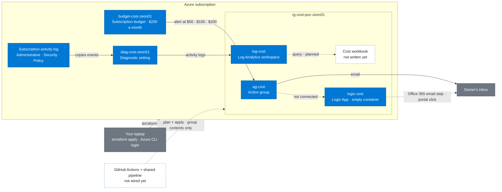

# Architecture snippet (DRAFT, Oct 28, 2026)

The live map is in the README. This file is the draft note. Names come from the Terraform files. `backend.tf` exists. Nothing is applied yet. GitHub Actions stays unwired until the three Azure secrets and the projects map are set.

*Caption: The subscription budget warns the action group at $50, $100 and $200 of actual spend, and the action group emails the owner. The activity log is copied into a Log Analytics workspace by a subscription-level diagnostic setting. The budget and that setting sit outside the resource group, so the nightly delete skips them and the pipeline cannot create them; they are applied from the laptop. The Logic App's email step is a portal click and is not connected to the action group.*

## Before this goes in the README

- [ ] Redraw the design picture from the finished files and save it as `architecture.png` and `architecture.pdf` (the `-draft` files are placeholders).
- [ ] Add the Cost workbook once the query is approved, and move it out of the dotted state.
- [ ] Remove the "not wired yet" labels when `backend.tf` and the three GitHub secrets exist.
- [ ] Check it renders on the GitHub repo page, in light and dark mode.
